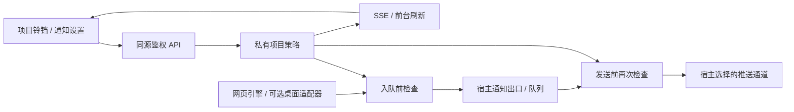

# 通知边界与接入

铃铛修改的是服务端项目策略。独立入口和嵌入入口使用同一接口；具体推送服务由宿主负责。



## HTTP 契约

`GET /codex-api/v1/project-notifications` 返回 `revision`、`newProjectEnabled`、`masterEnabled`、`codexEnabled` 和 `projects`。每个项目包含 `key`、`cwd`、`name`、`enabled`。使用 GET 返回的 key，不自行拼接；路径归属与显示名称分开，没有目录的事件使用 `unassigned`。

PUT 的三种载荷：

```json
{"revision":12,"action":"project","key":"path:/work/example","enabled":false}
```

```json
{"revision":12,"action":"all","enabled":false}
```

```json
{"revision":12,"action":"default","enabled":false}
```

成功返回最新完整快照；过期 revision 返回409，客户端读回，不自动重放不确定的写操作。全部开关只影响已有项目，默认值只影响之后首次识别的项目，不会开启总开关、来源或通道。GET/PUT均需登录，PUT还需CSRF。修改后发送 `project-notifications` SSE事件及 revision；UI另有前台恢复和可见期间刷新。

策略保存于私有 `project-notifications.json`，其中有实际项目目录，不能提交到源码仓库。

## 进程内契约

```js
import {createCodexWeb} from '../src/service.js';
import {ProjectNotifications} from '../src/project-notifications.js';

const policy = new ProjectNotifications(dataDirectory);
const service = await createCodexWeb({
  config, save, auth,
  paths: {dataDirectory, workspaceDirectory},
  projectNotifications: policy,
  notifications: hostNotifications,
  notificationStatus: () => ({masterEnabled: hostNotifications.enabled()}),
  onEvent(type) {
    if (type === 'project-notifications') hostNotifications.cancelDisallowed();
  },
});
```

`hostNotifications` 由宿主实现；必须提供 `enqueue(event)`，示例中的 `enabled()` 和 `cancelDisallowed()` 是宿主方法。包内新建的引擎先经过项目过滤，再调用出口。

事件包含 `source: 'codex'`、稳定去重用的 `id`、`kind`、`cwd`、`threadName`、`summary`、同源 `path`。目录、内容和链接是运行时私有信息，不应进入公开源码或公开日志。

注入 `services.codex` 时，已有引擎和监听器仍归宿主所有；模块不会自动重写它的通知对象。宿主应将既有引擎和桌面适配器的出口接入同一策略。只传入 `notifications` 参数不代表另一个已启动的引擎会自动改道。

## 宿主发送责任

1. 入队时记录 `policy.key(event.cwd)` 和当时的 `policy.value.revision`，同时检查总开关、来源/事件、项目及通道。
2. 发送前调用 `policy.allowedKey(row.projectKey, row.projectRevision)`，并重新检查总开关、来源/事件、通道、设备接收与会话权限。
3. 项目关闭时取消待发事件；关闭截止版本持久保存，关闭再开启、恢复旧队列或延迟请求也不得补发旧事件。
4. 若发送前含异步鉴权或网络等待，在最后发出请求前再次检查。已经由供应商接受的通知不能通过之后关闭铃铛撤回。
5. 存储、供应商凭据、设备标识、账号、证书和历史留在私有运行目录。

`notificationStatus()`只给UI展示状态，不代替真正的发送检查。项目策略不能覆盖宿主总开关。

## 独立默认行为

`npm start` 默认没有具体通知供应商，发送出口为空实现。接口、项目开关和默认值可以使用，但不会凭空发送手机推送或系统通知。需要通知时，通过上述工厂接入自己的发送器与状态；源码不依赖外部网站的私有管理服务。

桌面共享默认关闭，显式接入后产生的桌面事件仍经过同一策略。包内负责项目配置和通用事件，宿主负责推送供应商、设备、账号与最终投递。

验证使用临时目录、协议模拟引擎和假出口，覆盖鉴权、CSRF、持久化、冲突、过滤以及关闭再开启/恢复不补发，不向真实设备发送测试通知。
